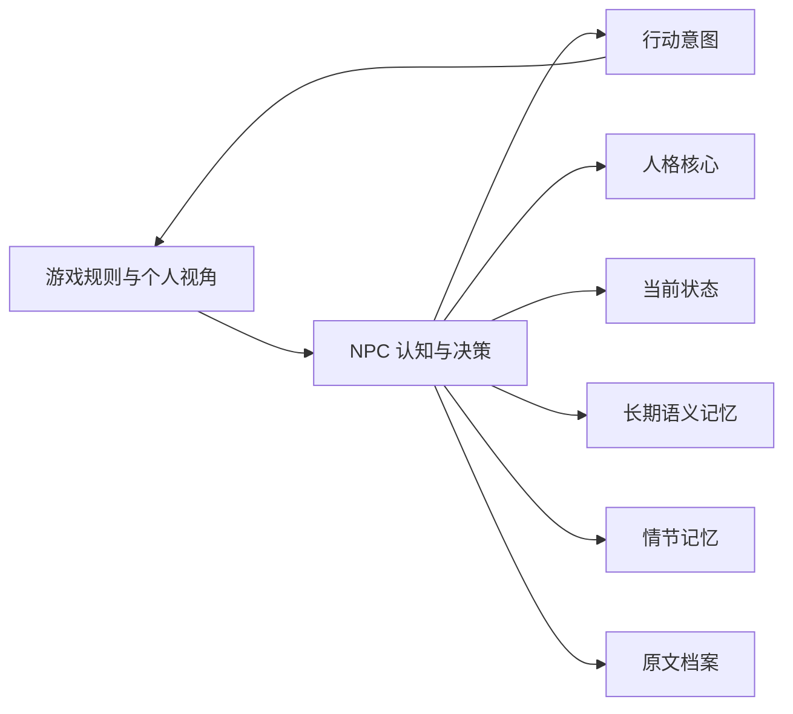

# GameAgentEngine

**面向多游戏的记忆增强 NPC Agent 引擎**

让同一个 NPC 保持稳定人格，并根据不同玩家的交互历史形成关系、信念与行动。

GameAgentEngine 参考 [Generative Agents](https://arxiv.org/abs/2304.03442) 的记忆、反思与规划思路，将 **NPC 认知核心**与**游戏自己的世界、规则和合法动作**分开。目前提供空间交互与隐藏信息回合制两类接入样例：稻妻城多智能体仿真、简化狼人杀。

[系统架构](#系统架构) · [核心能力](#核心能力) · [快速开始](#快速开始) · [示例与可视化](#示例与可视化) · [开发文档](#开发文档)

## 系统架构



[架构与模块边界](docs/architecture.md) · 历史图（2026-10，含已替代的三层称谓）：[PNG](docs/assets/gameagent-architecture.png) / [SVG](docs/assets/gameagent-architecture.svg)。

每个游戏通过适配器提供角色的个人视角、阶段目标与合法动作。NPC 根据人格和获准记忆返回结构化行动，游戏校验并结算，再将结果定向投递给对应 NPC。

- **游戏拥有规则与真相**：自己的 World、权威状态、信息可见性、推进顺序和胜负结算。
- **引擎提供可复用认知**：人格、记忆、关系、模型决策，以及可按场景启用的对话、反思与规划。
- **NPC 拥有自己的记忆**：每个 NPC 独立存储；游戏公共日志不会自动成为所有 NPC 的知识。

## 核心能力

| 能力 | 当前实现 |
|---|---|
| 个性化 NPC | 稳定人格与动态关系分开建模；面向玩家或其他 NPC 维护独立关系流、关系反思与信任判断 |
| 五类长期记忆 | 人格核心、当前状态、长期语义、情节与原文档案；每 NPC 独立两库，有界读取及按需回忆 |
| 组合历史查询 | 按参与者、发言者、地点、时间、事件类型与事件锚点组合筛选，支持全文检索、计数与稳定分页 |
| 证据约束认知 | 自我/关系反思、身份信念、证据引用、语义去重、矛盾强度判别、置信度衰减及失效过滤 |
| 空间规划与行动 | 日计划、一次子任务分解、事件反应与重规划；局部感知、人格/信任调制的效用决策及自主行动 |
| 推理成本治理 | 空间场景按玩家距离调度 full / compressed / idle，结合决策门控、缓存与有界证据候选控制开销 |
| 持久化与恢复 | 原文先归档、派生失败补处理、幂等事件投递、NPC 两库检查点及世界/适配器状态保存 |
| 仿真与回放 | Phaser 像素风空间回放、狼人杀席位与票型展示、直播跟随，以及公共/上帝视角分离 |

### 人格与关系

```text
NPC 的自我
  稳定人格 + 自我反思 + 自己获知的世界记忆

NPC 面向某个对象的关系
  关系观察 + 关系反思 + 信任判断

当前游戏角色
  本局身份 + 阵营/目标 + 当前阶段 + 获准个人视角
```

长期人格与本局身份分开；“共享流”指当前 NPC 内部的共享记忆，不是所有 NPC 共用的数据库。普通对话读取当前对象的关系流与该 NPC 的共享流；游戏决策按实例与时间上界读取个人档案。

### 五类记忆与读取策略

| 类别 | 当前内容 | 更新与读取 |
|---|---|---|
| 人格核心 `persona_core` | 名称、人格数值、背景、价值观、底线、表达风格、长期动机、版本 | 显式配置及版本更新；自动反思不覆盖 |
| 当前状态 `current_state` | 时钟、认知档位、运行计划、当前活动及有效计划记忆 | 从 NPC/PlanState 与主库组合副本；情绪和承诺自动维护尚未实现 |
| 长期语义 `semantic` | 自我/关系反思、可修正身份信念 | 对应 reflection/identity，可取证、衰减或失效 |
| 情节 `episodic` | 具体观察、交互经历及情节摘要 | 对应 observation/episode，保留来源与证据 |
| 原文档案 `raw_archive` | 实际输入、对话、动作及派生记录来源 | 追加保留，全文及事件查询；原文按引用显式读取 |

五类是唯一记忆组织方式；近期优先、重要性过滤、按需检索和上下文预算是读取策略。每个 NPC 仍使用两个 SQLite 文件，原有类型和整数证据 ID 保持；派生记忆合并、降权或失效不会删除原文。

通过引擎内部接口查看五类（`npc` 为已有 NPC）：

```python
from game_agent.memory import EventScope

scope = EventScope(as_of=npc.game_time, player_id="Aria", include_shared=True)
memory = npc.memory_categories(scope, limit=16)
print(memory.persona_core.values)
print(memory.current_state.current_activity)
print(memory.semantic, memory.episodic)
for ref in memory.raw_archive:
    source = npc.store.read_event_source(ref.source_id, scope)
    print(source.content if source else "")
```

该接口组合当前配置、运行态及范围内记录，不自动作为对话内容外发。历史记录使用 `npc.store.organize(EventScope(as_of=过去时间), limit=16)`；指定游戏实例时仅返回该实例原文引用，不借用无实例字段的旧派生记忆。`PersonaProfile` 可通过 NPC 构造或 create 的 `persona_profile` 参数注入；`set_persona_profile` 显式修改时须提高版本，再用 `save()` 保存。旧 `persona_traits` 可变接口继续兼容。

本轮完成组织、配置和恢复接口；新增背景、价值观等字段尚未统一注入所有生成出口，不代表防 OOC 效果已验证。

当前有两条上下文路径：

- **普通对话 `NPC.speak`**：近期背景及语义概况有界读取；明确寒暄只用背景，其他信息查询调用原文混合检索。核心证据、有限邻文和去重背景共用 3000 字符预算，不自动刷新访问时间；category 表示五类，usage 表示背景或回忆用途。
- **通用游戏 `NPC.decide_game`**：使用个人视角、人格及本局最近事件；默认历史窗口为 16 条、6000 字符，不自动检索远期历史。日程和关系反思由游戏选择启用。

通用事件查询接口已经提供；将任意自然语言历史问题自动拆解为查询步骤的规划器仍是后续工作。详见 [五类记忆](docs/modules/five-category-memory.md)、[读取策略](docs/modules/tiered-memory.md)与[事件查询](docs/modules/memory-events.md)。

### 原文混合检索

完整的[记忆组织层次图与检索流程图](docs/memory-diagrams.md)提供 SVG、PNG 和可编辑 DOT，标明当前实现与未实现边界。

`MemoryStore.hybrid_retrieve` 在同一原文来源上融合 FTS5/BM25 和向量候选，再做 RRF、来源归并及可选重排。摘要和反思可导航到其引用的原文，生成内容不作为额外事实刷票；较早、低重要性的经历不受近期重要性窗口排除。关系、实例和时间范围在候选生成前应用。

```python
from game_agent.memory import EventScope

scope = EventScope(as_of=npc.game_time, player_id="Aria", include_shared=True)
progress = npc.store.index_archive(scope, limit=256)  # 显式补一批原文向量
result = npc.store.hybrid_retrieve("修理蓝铜剑的进展", scope, top_k=8)
print(progress, result.diagnostics)
for hit in result.hits:
    print(hit["source_id"], hit["content"], hit["ranks"])
```

大档案可重复限批补建，检查 errors 并在 complete=True 后使用完整 dense 覆盖；查询默认最多补 64 个片段，未补完会返回 dense_complete=False。混合模式在 embedding 失败时保留词法候选并报告原因；`mode="bm25"` 不调用 embedding，`mode="dense"` 可用于语义单路对照。明确实例范围只查本局；未指定实例时仅查非游戏实例原文。

片段向量保存在同一个 archive.db，随两库检查点备份，重启按编码器、维度和版本复用；更换同名模型权重时需显式提升 MemoryStore 的 embedding_version。当前为流式精确扫描，不含 ANN 或大规模延迟承诺。指代解析、自然语言第 N 次查询和真实召回质量仍需后续验证。接口、降级及验收见[混合检索设计](docs/modules/hybrid-retrieval.md)，评测入口见[LongMemEval 对照](evals/longmemeval/README.md)。

## 快速开始

需要 **Python 3.10+**。引擎运行时仅依赖 Python 标准库；开发测试使用 pytest，网页可视化另需 Node.js 与 npm。

在仓库根目录执行：

```bash
python3 -m venv .venv
source .venv/bin/activate
python -m pip install -e '.[dev]'

# 默认使用离线演示模型，不连接 LLM 服务
python examples/game_adapters.py --game werewolf --persona-seed 42
python examples/game_adapters.py --game spatial
```

Windows 激活虚拟环境时使用 `.venv\Scripts\activate`。

两个命令都会创建新的临时运行目录，并在结束后输出路径；其中包含 NPC 数据、公共结果和适配器私有快照。也可用 `--data-dir <空目录>` 指定位置。离线演示用于验证接入和运行链路，其固定决策不代表模型的博弈能力。

## 示例与可视化

### 狼人杀：隐藏信息与阶段决策

默认 10 人局：**3 狼 + 预言家 + 女巫 + 猎人 + 4 村民**。支持狼人夜间密谈与目标投票、预言家查验、女巫用药、猎人开枪、白天发言与投票结算。人格可通过种子复现；身份与技能反馈仅投递给获准接收者。

生成一局离线回放并打开网页：

```bash
python examples/werewolf_visual.py --god --persona-seed 42
cd visualization
npm ci
npm run dev
```

| 页面 | 用途 |
|---|---|
| `http://localhost:5173/werewolf.html` | 公共视角：席位、阶段、发言、票型、淘汰与结局 |
| `http://localhost:5173/werewolf.html?god` | 本地上帝视角：额外加载身份与私密事件 |
| `http://localhost:5173/werewolf.html?live` | 跟随运行器输出的直播文件 |

公共时间线与私密文件分开；`--god` 显式将上帝文件放进前端 public 目录，仅供本地演示和调试。需要真实模型时，在配置好客户端后给运行器加 `--real-model`。规则与回放格式见 [游戏接入](docs/modules/game-integration.md) 和 [对局回放](docs/modules/game-replay.md)。

### 稻妻城：空间交互与自主行动

`world_auto_sim` 以稻妻城为舞台，包含 **5 个 NPC、1 个玩家 Agent、6 个区域**，支持空间感知、自主行动、对话、事件反应、距离认知调度及场景效果。

```bash
# 需要已配置且可访问的真实模型服务；不是离线快速开始
python examples/world_auto_sim.py

# 将本次结果放入前端静态目录，供 ?timeline=timeline.json 读取
cp data/auto_sim/timeline.json visualization/public/timeline.json
```

运行器会重建该示例的数据目录并输出时间线、直播文件与检查点；需要继续既有世界时使用恢复接口。前端首页默认展示离线样本，`http://localhost:5173/?timeline=timeline.json` 加载上面复制的结果，`http://localhost:5173/?live` 跟随直播。更多操作见 [可视化说明](visualization/README.md)。

### 其他示例

| 入口 | 内容 |
|---|---|
| [`examples/demo_real.py`](examples/demo_real.py) | 同一 NPC 面向不同玩家的关系差异 |
| [`examples/game_loop.py`](examples/game_loop.py) | 单 NPC 的规划、观察、对话与事件反应 |
| [`examples/persistence.py`](examples/persistence.py) | 跨会话持久化与加载 |
| [`examples/forgetting.py`](examples/forgetting.py) | 时间推进后的记忆降权 |
| [`examples/world_demo.py`](examples/world_demo.py) | 脚本驱动的空间世界 |
| [`examples/replay.py`](examples/replay.py) | 终端时间线回放 |

除默认离线的游戏适配与狼人杀回放外，认知示例通常需要真实模型。具体依赖见各入口。

## 模型接入与 NPC 使用

`RealLLM` 使用 OpenAI 兼容的 `/v1/chat/completions`，`RealEmbedder` 使用 `/v1/embeddings`。地址、模型名和密钥通过构造参数传入；代码默认值保留原实验部署配置，接入自己的服务时应显式覆盖。

```python
import os

from game_agent import NPC, HashEmbedder, RealLLM

llm = RealLLM(
    base_url="http://localhost:8000",  # 服务根地址，客户端会追加 /v1/chat/completions
    model="your-chat-model",
    api_key=os.environ.get("MODEL_API_KEY", ""),
)

npc = NPC.create(
    "Isabella",
    {"social": 0.8, "goal_oriented": 0.3},
    llm=llm,
    embedder=HashEmbedder(),
    data_dir="data/npcs",
)
try:
    npc.observe("Aria 帮我整理了菜单。", now=10.0, player_id="Aria")
    print(npc.speak("Aria", "今天生意怎么样？", now=10.5))
    npc.save()
finally:
    npc.store.close()
```

`HashEmbedder` 是离线词袋哈希，只反映词面重叠。需要语义向量时，可替换为配置好的 `RealEmbedder`；`make_embedder()` 会尝试原默认向量端点，不可达时回退。模型接口、JSON 修复与调用统计见 [模型接入设计](docs/modules/model-adapters.md)。

示例脚本中的 `--real-model` 使用 `RealLLM()` 默认构造，不提供端点命令行参数；自定义服务可像上例构造客户端，再通过运行器的 `model` 参数或稻妻运行器的 `llm_factory` 注入。

### 持久化与恢复

```text
data/npcs/
├── Isabella.db          # 派生记忆、证据关联与 NPC 元数据
└── Isabella.archive.db  # 完整原文、全文/事件索引与补处理状态
```

- `NPC(...)` 默认是内存态；`NPC.create(...)` 创建或加载持久化 NPC，`NPC.load(...)` 显式加载已有主库及配对档案。
- 原文先归档；后续评分、嵌入或生成失败仍保留，可用 `npc.retry_pending_memories(limit=20)` 显式补处理。
- 备份 NPC 时需保存两个文件；完整空间世界使用 `World.save_checkpoint(...)`，通过 `World.from_checkpoint(...)` 恢复到新运行目录。
- 游戏适配器的私有快照与 NPC 档案需成套保存；实时写入不承诺跨库原子事务。详见 [持久化设计](docs/modules/persistence.md)。

## 接入新游戏

新游戏无须继承空间 `World`，按以下边界实现适配器：

1. 管理自己的权威状态、阶段、规则和结算。
2. 为当前行动者构造 `DecisionRequest`，包含个人视角、阶段目标及动态 `ActionSpec` / `ParameterSpec`。
3. 接收 `ActionIntent`，校验参数、请求与状态版本，并在执行前复核实际玩法规则。
4. 将结果转换成带稳定 ID、接收者与频道的 `GameEvent`，交给 `GameSession` 协调投递与后续决策。

核心协议位于 [`game_agent.integration`](src/game_agent/integration/)。可参考 [`SpatialAdapter`](src/game_agent/adapters/spatial.py) 与 [`WerewolfAdapter`](src/game_agent/scenarios/werewolf/adapter.py)，完整接口见 [多游戏接入设计](docs/modules/game-integration.md)。

## 验证与评测

```bash
# 默认离线测试；真实端点探针需显式启用
python -m pytest tests/ -q

# 前端测试与构建（先完成 npm ci）
cd visualization
npm test
npm run build
```

统一验收入口为 `python tools/check_project.py`，包含 Python、前端与独立 wheel 安装检查，需要本地 npm 依赖、uv 及已缓存的 Python 构建依赖。追加浏览器验收使用 `--e2e`，需已安装 Chromium。

评测包含记忆一致性四臂消融、人格/关系决策消融，以及认知调度的调用量与延迟对照。方法、历史结果和版本口径见 [`evals/README.md`](evals/README.md)：其中历史数字尚未按新的绝对 `importance / 10` 评分公式重跑，不作为当前版本效果结论。

当前已提供长期原文保留与有界上下文读取；任意自然语言历史查询、十万轮负载和大规模模型策略质量仍需单独验证。离线测试验证契约、隔离与恢复，不等同于真实生成质量评测。

## 开发文档

| 文档 | 内容 |
|---|---|
| [设计文档入口](docs/README.md) | 模块设计、实现状态与验证记录 |
| [系统总览](docs/architecture.md) | 模块职责、调用方向与状态归属 |
| [源码布局](docs/source-layout.md) | src 布局、正式包入口与安装规则 |
| [多游戏接入](docs/modules/game-integration.md) | 请求、动作、定向事件与会话协议 |
| [五类记忆](docs/modules/five-category-memory.md) / [读取策略](docs/modules/tiered-memory.md) / [事件查询](docs/modules/memory-events.md) | 职责分类、原文档案、检索路径与组合查询 |
| [NPC 编排](docs/modules/npc-runtime.md) / [反思](docs/modules/reflection.md) / [规划](docs/modules/planning.md) | 认知组件与触发逻辑 |
| [实验与评测](evals/README.md) | 基线、指标、消融设计与历史结果 |
| [可视化](visualization/README.md) / [狼人杀回放](docs/modules/game-replay.md) | 空间与对局展示、直播跟随 |

修改模块时遵循 [`AGENTS.md`](AGENTS.md)：**先更新设计，再实现和验证，最后按模块提交 Git**。早期总览、计划和审查记录已集中到[历史文档归档](docs/archive/README.md)，当前实现以 `docs/` 下对应模块记录与源码为准。
