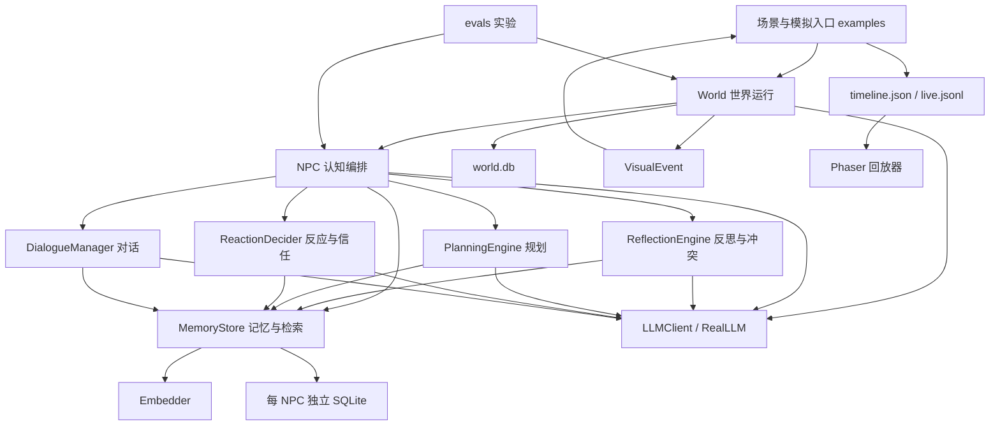

# 系统总览与模块边界

核对日期：2026-10-23。依据当前工作区代码、原有文档与本轮离线测试整理。本文是重构前的实现基线；标注为“建议”的内容尚未实施。

下文代码位置和行数描述重构前快照；最新模块迁移状态以 [模块实施记录](README.md#模块实施记录) 和对应蓝图为准。

当前物理目录已迁入 `src/game_agent/`，按模块分包，完整布局和安装方式见 [源码布局与包命名](source-layout.md)。旧 `persona_agent` 导入兼容层已按用户要求移除。

## 项目定位

项目主体是 `GameAgentEngine/`，Git 仓库也位于该目录。上层目录的简历材料和 `projects/` 演示稿产物不属于引擎模块。

这是一个以“千人千面”为核心的 LLM NPC 框架，已经扩展出多智能体世界模拟、社交传播、持久化、实验评测和像素风回放。核心包为 `persona_agent`，版本声明为 `0.1.0`。

核心建模为：

```text
NPC 的共享自我 = 人格特质 + 世界记忆 + 自我反思 / 身份信念
NPC 对实体 e 的关系面 = 关于 e 的观察 + 关系反思 + 派生信任
行为输入 = 共享自我 + 当前相关关系面 + 计划 + 当前可感知情境
```

代码字段仍叫 `player_id`，但关系对象已经扩展到 NPC 等实体。`player_id=None` 表示记录属于共享流；注意查询接口的默认值语义另有区别。

## 代码布局

| 目录 | 当前职责 |
|---|---|
| `persona_agent/` | NPC 认知、世界运行、模型适配、SQLite 存储；共 13 个 Python 源文件、4,394 行，包含集成探针 |
| `examples/` | 单 NPC 示例、脚本模拟、自治稻妻场景、终端回放；具体游戏规则主要仍在这里 |
| `evals/` | 记忆一致性、决策消融、认知调度三组实验及分析 |
| `tests/` | 246 个离线测试，另有 6 个依赖真实模型的集成探针 |
| `visualization/` | TypeScript + Phaser + Vite 的只读回放器、时间线读取、直播跟随与美术资源 |
| `tools/` | NPC 记忆库审查工具 |
| `data/` | 运行时生成的数据库、时间线和实验结果；当前检出中未见该目录 |

Python 运行时代码使用标准库，测试依赖 pytest。真实推理和语义向量依赖外部兼容接口。前端有独立的依赖与构建流程；当前没有 `pyproject.toml`，示例普遍自行插入模块搜索路径。

## 当前依赖与数据流



前端消费模拟产物，通过 JSONL 文件轮询跟随运行进度。目前没有独立的实时游戏服务端或玩家操作 API。

## 核心模块现状

| 模块 | 当前实现与入口 | 状态归属及边界 |
|---|---|---|
| 记忆与检索 | `memory.py`：`MemoryRecord`、`MemoryStore.add/retrieve/all_valid` | 存储观察、反思、计划、情节和身份信念；同时承担 SQLite、向量缓存、检索评分、合并及遗忘 |
| 反思与信念 | `reflection.py`：`reflect_self/reflect_relationship/reflect_identity/check_conflicts` | 负责证据、去重和冲突处理；触发时机由 NPC / World 编排 |
| 规划 | `planning.py`：`make_daily_plan/replan_from_now` | 计划记录进入记忆；NPC 同时维护当前计划块，World 负责每日触发及行动后打断 |
| 事件反应与关系 | `reacting.py`：`relationship_trust/decide` | LLM 判断信任与事件价值，效用函数决定是否响应；持有信任和事件价值缓存 |
| 对话 | `dialogue.py`：`reply/two_agent_exchange` | 基于当前关系面与共享记忆生成回复；对话记录及部分触发逻辑由 NPC / World 负责 |
| NPC 编排 | `npc.py`：`observe/speak/react/generate_daily_plan/save/load` | 组装认知组件，维护时间、档位、反思门控、决策缓存、计划块及部分持久化元数据 |
| 世界运行 | `world.py`：`World.step/step_autonomous/execute_action` | 管实体、空间、档位、自治循环、行动、社交、谣言、行为链、视觉事件和世界持久化 |
| 模型适配 | `llm.py/llm_real.py`、`embeddings*.py` | 12 类推理接口、兼容 HTTP 调用、提示词、结构化解析、重试和调用统计；向量有真实与哈希实现 |
| 稻妻场景 | `examples/world_auto_sim.py`、`world_sim.py` | 人物、地图、目标、锻刀、证据提取、说服裁决、结局判断与输出文件 |
| 回放展示 | `visualization/src/` | 时间线读取与兼容、播放控制、场景渲染、角色、气泡、HUD 和资源 |
| 评测 | `evals/`、`probes.py` | 消融配置、场景、指标、模型裁判、调用成本及真实模型行为探针 |

### 两条不同的决策路径

这是后续设计必须明确的一点：

- **事件反应**：`NPC.react → ReactionDecider.decide`，按人格、信任、事件价值与打断成本计算效用，再生成反应；可能触发重规划。
- **自治行动**：`World.step_autonomous → decide_agent → LLMClient.decide_action`，把目标、可见状态、记忆及信任拼入上下文，由 LLM 直接选择行动，然后执行。

自治行动并不统一经过 `ReactionDecider.decide` 的效用判断；它复用了其中的信任查询。因此，“效用决策消融”不能直接代表整个自治行动策略的效果。是否统一两条路径，应先在设计中确定，不能在拆文件时顺手改变。

### 一步自治模拟

```text
推进时钟与距离档位
→ 到日触发计划 / 到时触发固化
→ 收集存活实体的决策（全部决策先于行动执行）
→ 按实体遍历顺序逐个执行行动，记录结构化事件
→ 重大行动触发重规划
→ 重感知、自我反思、社交关系反思
→ 保存世界与 NPC 状态
→ 场景脚本补充结局判断，生成快照并输出时间线
```

这是“先决策、后顺序执行”，并非同时结算。执行中的死亡即时生效，后执行实体可能失去行动机会；当前没有证明结算顺序无偏。

`World.step` 则是外部驱动世界更新：自动计划、调档、感知、认知维护与保存，不主动为所有实体选择并执行自治行动。

## 关键契约与必须守住的语义

1. **关系隔离**：对话检索只使用当前对象的关系面与共享流；不同 NPC 各自持有记忆库。世界自治决策允许纳入视距内多个对象的关系记忆，这和单一对话者检索是不同的上下文政策。
2. **查询作用域明确**：`MemoryStore.all_valid(player_id=None)` 表示不过滤关系流；`shared=True` 才表示仅共享流。不能根据记录字段的 `None` 语义推断查询语义。
3. **反思证据**：默认只引用观察，消融可放开；自我、关系和身份反思的范围必须分别定义。
4. **遗忘与失效不同**：遗忘降低重要性、保留记录；冲突处理可降低置信度或使信念失效。固化观察仍可检索，只退出相应冲突扫描。
5. **信任来自关系记忆**：当前信任判定不输入 importance，因而没有直接按时间降低信任的机制；但使用有上限的记忆窗口，不能宣称无限期完整保留每个旧事件的影响。
6. **档位与成本**：距离决定 full / compressed / idle；自治决策的 idle 等待需要启用 `decision_tier_gate`，默认关闭。每日计划也没有统一受 idle 门控，不能把 idle 无条件等同于全部推理零成本。
7. **事件契约**：新格式使用 `VisualEvent` 作为行动输出事实；中文 `events` 为派生展示。旧格式兼容仍会解析中文串，需作为明确的兼容路径保留或迁移。
8. **存储边界**：`world.db` 与各 NPC 数据库分开保存，向量缓存不持久化。现有保存流程不是跨库原子事务，也不是完整的进程检查点。
9. **失败语义**：单实体决策、感知或规划失败尽量不阻断整步；部分认知写入采用尽力完成。当前异常降级与记录较分散，不能将这些保证概括为全流程事务回滚。

## 重构的主要动因

| 观察到的现状 | 修改设计时的影响 | 建议方向 |
|---|---|---|
| `world.py` 1,330 行，集中了实体、循环、行动、社交、事件与存储 | 改一个机制需要理解大量其他机制 | 保留 World 门面，逐步拆出有明确输入输出和状态归属的组件 |
| `MemoryStore` 同时实现数据访问与认知策略；NPC 也持有不少运行状态 | 规则、缓存及保存时机容易交叉 | 先列状态清单，再确定检索、维护策略和存储接口边界 |
| World、示例及评测访问 `_tier`、`_agent_llms` 等私有字段 | 模块拆分容易影响多个调用方 | 提供必要的配置与查询接口，逐步替换跨模块私有访问 |
| 稻妻规则已通过钩子部分解耦，但仍集中在大型示例脚本；时间线含 `shogun_dead/decree_ended` 等字段 | 更换场景要同时改脚本、数据契约与展示 | 独立场景定义、规则、结局状态，通用时间线设计场景扩展区域 |
| `InazumaScene.ts` 708 行，承担加载、直播、播放、渲染与交互协调 | 数据源或场景变化容易影响展示整体 | 固定时间线契约后，再拆分数据源与场景协调职责 |
| 默认模型地址、模型路径和示例输出路径写在代码中 | 环境迁移、复现实验与保护已有运行数据较麻烦 | 设计统一配置入口与独立 run 目录；注意示例会清理其固定输出目录 |
| 原有总览、计划与历史修复记录分散，部分注释仍保留修复前描述 | 无法快速确定哪份设计代表当前行为 | 新设计统一进入 docs；以代码和验证核对旧材料，保留历史证据 |

现有 `ReactionDecider`、`PlanningEngine`、`DialogueManager`、模型与向量接口已提供可复用边界。重构可围绕这些接口渐进推进，不必先更换技术栈。

## 模块蓝图目录（拟建）

以下是后续设计稿的职责划分，**文件尚未建立**。这是一组文档边界，不要求代码立即拆成同名包。

| 拟建蓝图 | 设计重点 | 当前代码映射 |
|---|---|---|
| `modules/memory.md` | 记录类型、流作用域、检索评分、去重、遗忘、向量缓存 | `memory.py` |
| `modules/reflection.md` | 三类反思、证据约束、冲突策略、身份与情节关系 | `reflection.py`、`NPC.consolidate` |
| `modules/planning.md` | 游戏时间、日计划、分解、打断、失效与恢复 | `planning.py`、NPC 计划状态、World 触发逻辑 |
| `modules/decision.md` | 信任、事件效用与自治行动的关系、动作输入输出 | `reacting.py`、`World.decide_agent` |
| `modules/dialogue.md` | 对话可见性、双方记忆回流、多轮终止、失败写入 | `dialogue.py`、`NPC.speak`、World talk 分支 |
| `modules/npc-runtime.md` | 组件组装、认知生命周期、门控、缓存和公开门面 | `npc.py` |
| `modules/world-runtime.md` | 实体、感知、调度、步进阶段、行动结算、社交与钩子 | `world.py` |
| `modules/model-adapters.md` | 模型能力接口、提示词、配置、解析、重试、用量统计及向量回退 | `llm*.py`、`embeddings*.py` |
| `modules/persistence.md` | 状态归属清单、跨库保存、恢复一致性、配置与版本迁移 | `MemoryStore`、`NPC.save/load`、`World.save/load` |
| `modules/scenarios.md` | 场景配置、规则注册、目标、证据、裁决、结束条件和运行产物 | `examples/world_auto_sim.py` 等 |
| `modules/visualization.md` | 时间线契约、旧格式兼容、数据源、播放、渲染和场景资源 | `VisualEvent`、前端 `schema.ts` 与回放实现 |
| `modules/evaluation.md` | 机制与指标对应、消融配置、离线与真实模型验证、运行证据 | `evals/`、`tests/`、`probes.py` |

世界层、记忆层与持久化蓝图应分别声明：谁拥有状态、谁允许修改、何时保存、恢复后如何重建。相同机制只在其责任模块定义规则，其他文档引用该定义。

## 已有能力与后续功能

当前已实现：关系面隔离、记忆维护、证据反思与冲突、规划与重规划、信任调制反应、多实体世界、自治行动、可选社交 / 谣言 / 固化 / 身份信念、数据库恢复、回放与实验脚本。

原 `NextPlan.md` 仍列为未完成：关系阶段与修复 / 称呼、idle 低成本自治、多轮对话终止机制。现有 idle 规则等待不等于能够推动世界的 idle 自治。这些属于功能设计，建议在结构重构后单独推进。

## 本轮验证

- 用户补充确认：真实模型 API 当前不可达，现阶段仅做代码重构；真实模拟、探针和在线效果评测不作为本阶段验收条件。
- 执行 `.venv/bin/python -m pytest tests/ --ignore=tests/test_probes.py -q`：**246 passed in 3.72s**。
- 6 个真实 LLM 探针未运行；端点不可达信息来自用户，本轮未探测端点或验证真实生成行为，未重跑历史实验结果。
- 前端未安装 `node_modules`，本轮未运行构建与浏览器 E2E。
- 本轮只新增设计文档入口和总览材料，没有修改运行时代码。

离线通过说明现有确定性约束有可用基线；不能替代真实模型质量、推理成本和交互涌现的验证。
