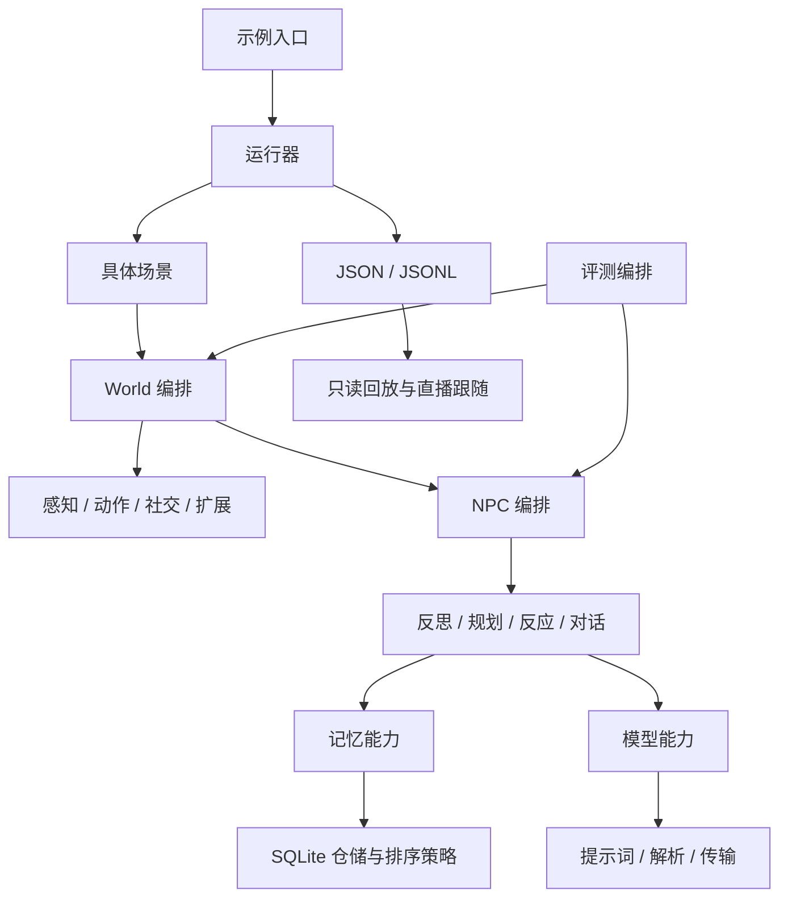

# 系统总览与模块边界

核对日期：2026-10-25。本文描述分模块重构后的当前实现；早期设计与实验历史仍保留在根目录原文档。详细设计与验证见 [模块实施记录](README.md#模块实施记录)。

## 项目与入口

Git 仓库位于 GameAgentEngine，正式 Python 包为 game_agent，采用 src 布局和 pyproject.toml 安装，发行版本仍为 0.1.0。旧 persona_agent 包及其兼容层已移除。外部通过 `from game_agent import NPC, World` 等正式入口使用引擎；子包按需加载。

核心模型保持：共享流承载世界观察、自我反思、身份信念和计划；每个 player_id 承载独立关系面，包括 NPC 等实体。记录的 player_id=None 表示共享流，但 all_valid(player_id=None) 表示不过滤，查询共享流必须显式 shared=True。

## 当前结构

| 目录 | 责任 | 设计 |
|---|---|---|
| src/game_agent/cognition/npc/ | 组件组装、业务调用顺序与运行状态协调 | [NPC](modules/npc-runtime.md) |
| cognition/reflection/ | 反思生成、证据写入、冲突处理 | [反思](modules/reflection.md) |
| cognition/planning/ | 时间规则、计划记忆、PlanState 与生成编排 | [规划](modules/planning.md) |
| cognition/reacting/ | 事件评分、关系信任、纯效用与各自缓存 | [事件反应](modules/reaction.md) |
| cognition/dialogue/、autonomous.py | 对话上下文/生成/轮流，以及独立自治输入 | [对话](modules/dialogue.md)、[自治](modules/decision.md) |
| src/game_agent/memory/ | 派生记忆、每 NPC 原文档案、持久检索索引、排序、维护及门面 | [记忆](modules/memory.md)、[分层](modules/tiered-memory.md) |
| src/game_agent/world/ | 实体、事件、感知、动作、社交、扩展、快照及循环编排 | [世界循环](modules/world-runtime.md) |
| src/game_agent/models/ | 能力接口、配置、单次 HTTP、任务提示词、解析、重试与统计 | [模型接入](modules/model-adapters.md) |
| src/game_agent/scenarios/inazuma/ | 人物地图、具体效果、裁决、结局与脚本剧情 | [场景](modules/scenarios.md) |
| src/game_agent/runners/ | 显式运行、目录及 JSON/JSONL；终端与静态 HTML 回放 | [场景](modules/scenarios.md)、[回放](modules/visualization.md) |
| src/game_agent/evaluation/ | 纯指标、结果格式、显式运行依赖与真实探针 | [评测](modules/evaluation.md) |
| evals/fixtures/、experiments/ | 预定义试验数据、固定基线、试验及汇总编排 | [评测](modules/evaluation.md) |
| visualization/src/ | 只读加载、播放控制、投影、事件呈现、交互、直播及 UI/美术 | [回放](modules/visualization.md) |
| examples/、tests/、tools/ | 示例入口、离线验证及数据库审查工具 | [源码布局](source-layout.md) |

表中 cognition 子目录均位于 src/game_agent/ 下。完整物理布局和安装规则见 [源码布局](source-layout.md)。

## 调用与产物方向

World 不导入稻妻场景或运行器；场景通过公开钩子注册效果。纯规则、记录和指标导入不加载 SQLite 或真实适配器。认知组件接收所需模型/记忆能力，不获取整个 World；NPC 负责组装及调用时机，子组件不反向获取 NPC。

## 状态唯一归属

| 状态 | 所有者 | 保存范围 |
|---|---|---|
| 记忆记录、有效性、证据、置信度及重要性 | MemoryRepository / MemoryStore | 每 NPC 主库；有界向量缓存重建 |
| 原文、片段索引及补处理队列 | 每 NPC ArchiveRepository | 独立 archive.db，与主库配对；完整检查点同时备份 |
| 时钟、档位、累积、反思水位及共享冲突签名 | NPC RuntimeState | 实时库按原键保存；独立检查点另保存档位、累积及签名 |
| 计划块和中断兜底 | PlanState | 实时库保存计划块；独立检查点另保存中断兜底 |
| 完整反应 LRU | NPC ReactionCache | 不持久化；512 上限 |
| 事件评分 LRU、关系信任签名缓存 | EventScorer、RelationshipTrust | 不持久化；分别清理，不暴露可变缓存 |
| 世界实体、认知/自治绑定、时钟、每日锚点、钩子和社交队列 | World 及对应组件 | 实时库仍分库；完整检查点同时保存配置/水位/队列/链计数，模型与钩子显式重绑定 |
| 输出目录、时间线累积及直播文件 | Runner / TimelineWriter | 逐行 flush；直播新增 run_id，正常结束发布独立检查点 |
| 播放游标、投影、对话队列、指针路由、直播摄入 | 各前端组件 | 仅浏览器运行态，不写世界/NPC |

公开诊断返回状态/数量副本或名称元组；生产场景与评测经 World 注册/查询 API 使用引擎，不读写私有注册表。

## 行为约束

- 记忆仍使用 SQLite，importance 检索权重保持绝对 importance/10；recency/relevance 的原归一化不变。
- 对话只使用当前对象关系面与共享流；自治仍可合并共享流与全部可见对象关系面并取原末 5 条，不擅自改为先选目标。
- 事件反应与自治行动继续分开；效用阈值、信任取证、缓存键与失效边界、计划时刻及回流顺序不变。
- 实时库不承诺跨库事务；保存失败明确上报，完整检查点通过独立代与清单发布，恢复到新运行目录。
- 默认模型、超时/退避、JSON 修复、统计口径、试验参数、场景数值和运行目录策略保持；对话提示词按已确认分层设计调整为区分背景/原文及允许无历史交流。
- 旧时间线读取属于现有回放行为，仍受验证；它与已移除的 Python 包兼容层无关。

## 当前验证边界

当前仅重构与离线验收，不调用真实模型 API、真实探针、在线评测或真实模拟。测试与对照使用固定替身、临时目录、已有历史样本和确定性时间线。真实模型质量、服务恢复及策略效果不由这些检查证明，需后续单独验证。

当前结构重构记录见 [重构与验收](refactoring.md)，2026-10-25 的正确性修正及 453 个离线测试验收见 [可靠性计划](reliability-plan.md)。

## 2026-10-25 正确性修正

共享观察去重限定共享流，保持全量查询语义。信任缓存按实际有序模型证据失效；完整反应使用实际信任、完整计划和人格的结构化键，评分缓存同样区分人格。直播按成功行推进，坏行原位重试；文件替换提示重新加载，异步摄入和场景组装限制单次在途。默认 pytest 跳过在线探针并拦截外部网络，统一验收入口为 `tools/check_project.py`。

## 2026-10-25 分层记忆

每 NPC 使用独立主库与独立原文档案；先归档再派生，失败保留待处理来源。常用层按近期/概况及字符预算加载，明确历史意图才检索重要层与原文，关系/共享和时间边界保持。新检查点 v2 包含每 NPC 两库，旧 v1 以历史快照兼容。最终 Python 离线全集 481 项通过、6 项跳过；独立 wheel 安装和恢复通过。关系反思全量读取的额外调整待用户确认；细节、已知限制及验证见 [分层设计](modules/tiered-memory.md)。
