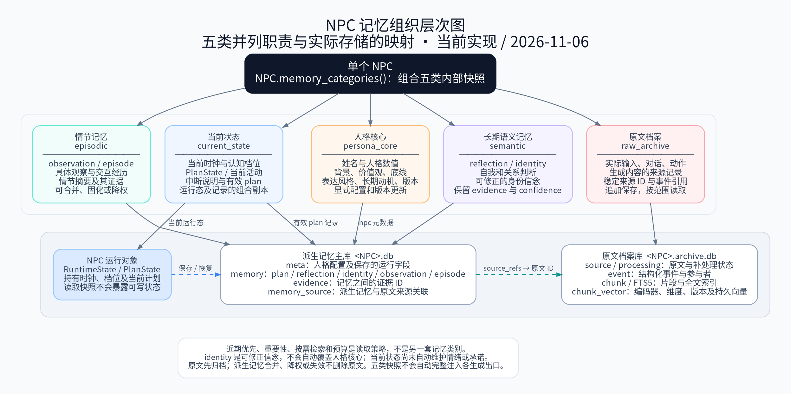
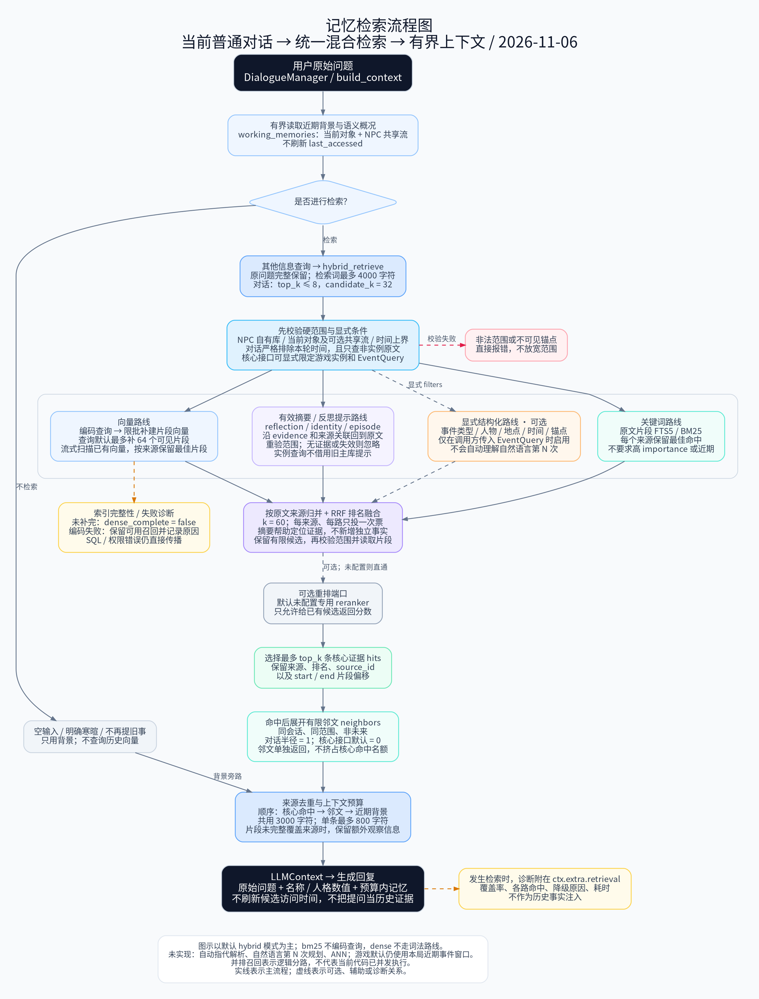

# 记忆组织与检索图解

核对日期：2026-11-06。对应 [五类记忆](modules/five-category-memory.md) 与 [混合检索](modules/hybrid-retrieval.md) 当前实现。

## 记忆组织层次图

这里的层次指“单个 NPC → 五类职责 → 实际承载”。五类并列，不表示访问优先级；时间、重要性和预算是读取策略。



[SVG 矢量图](assets/memory-organization.svg) · [PNG 预览](assets/memory-organization.png) · [DOT 可编辑源](assets/memory-organization.dot)

- 人格核心与当前状态由 NPC 所有；主库保存人格元数据和派生记忆，档案库保存原文及索引。运行对象不构成第三个数据库。
- 主库中的 evidence 指向支持某条认知的其他记忆 ID，source_refs 则连接派生记忆与档案原文，两者职责不同。
- identity 是可修正信念，不自动改写人格配置。旧 persona_traits 显式可变接口仍保留，本图不表示已有不可绕过的人格锁。
- 情绪、承诺自动维护及统一注入完整人设尚未实现；五类内部快照不等于对玩家公开的上下文。

## 记忆检索流程图

图示以普通对话的信息查询和默认 hybrid 模式为主。并排候选路线表示逻辑分路，不表示当前代码已并发执行。



[SVG 矢量图](assets/memory-retrieval-flow.svg) · [PNG 预览](assets/memory-retrieval-flow.png) · [DOT 可编辑源](assets/memory-retrieval-flow.dot)

- 先读取有界背景；明确寒暄旁路历史检索，其他信息查询进入核心接口。生成端仍收到完整原问题。
- 所有返回证据均须满足 NPC、关系、时间、实例及显式过滤范围。普通对话严格排除本轮时间与实例原文，核心 API 则可明确指定实例。
- BM25 与 dense 在原文来源上融合；有效摘要仅沿证据定位原文。无来源、失效或越界提示不变成独立经历。
- 当前默认最多补建 64 个可见片段向量；索引未完整或编码失败会记录诊断。检索器使用流式精确扫描，未实现 ANN。
- 可选重排器默认未配置。排序后选核心命中，再单独返回有限邻文；预算阶段先核心、再邻文、再背景，合计 3000 字符。
- 自动指代解析及自然语言“第 N 次”规划尚未实现；通用游戏默认仍读取本局近期事件，没有在此图中被画作已接入混合检索。

## 文件与重绘

两张图均提供 DOT、SVG 和 PNG。可在已安装 Graphviz 及中文字体（本次使用 Noto Sans CJK SC）的环境，从仓库根目录重绘：

```bash
dot -Tsvg docs/assets/memory-organization.dot -o docs/assets/memory-organization.svg
dot -Tpng -Gdpi=144 docs/assets/memory-organization.dot -o docs/assets/memory-organization.png
dot -Tsvg docs/assets/memory-retrieval-flow.dot -o docs/assets/memory-retrieval-flow.svg
dot -Tpng -Gdpi=144 docs/assets/memory-retrieval-flow.dot -o docs/assets/memory-retrieval-flow.png
```

Graphviz 仅用于文档重绘，不是引擎运行依赖。旧 `gameagent-architecture.png/svg` 保留为历史材料，不覆盖。
