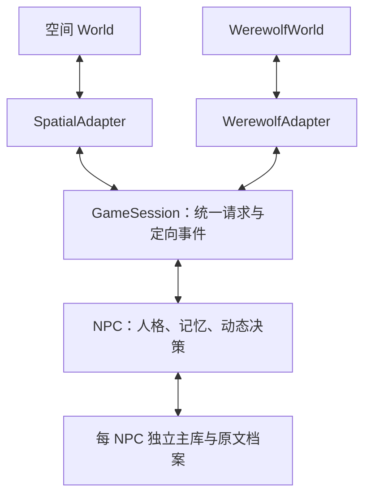

# 多游戏接入与 NPC 决策协议

状态：已实现并完成离线验收。设计日期：2026-10-25；2026-10-26 增加通用决策非法输出重试一次。关联：[NPC](npc-runtime.md)、[记忆事件](memory-events.md)、[世界](world-runtime.md)、[模型](model-adapters.md)、[场景](scenarios.md)。

## 目标与边界

每个游戏拥有自己的 World、权威状态、合法动作、可见性规则、推进顺序和结算；适配器通过统一协议调用 NPC。核心不理解狼人身份、投票或地图，不要求游戏继承空间 World。现有 World 继续作为空间实现，旧 world_auto_sim 和 RealLLM.decide_action 契约保留；新路径显式启用，不偷换原自治决策窗口、importance/10 或日程语义。

本轮新增 integration/ 轻量契约与会话协调，cognition/game.py 通用上下文，adapters/spatial.py 接入现有 World，scenarios/werewolf/ 提供独立阶段运行时。先用两个实际适配验证边界，不建通用规则 DSL 或巨大继承体系。



## 契约与职责

| 数据/能力 | 所有者 | 契约 |
|---|---|---|
| DecisionRequest | 游戏适配器 | instance_id、request_id、actor_id、状态版本、阶段、时间、目标、个人视角、规则说明和动作定义；仅提供获准信息，不能包含 World 对象 |
| ActionSpec / ParameterSpec | 游戏 | 开放动作名、说明、参数类型/枚举/范围；核心检查结构，游戏执行前再次检查真实状态 |
| ActionIntent | NPC | 绑定请求与角色，包含动作及参数；私人策略备注不进入公共事件 |
| GameEvent | 游戏 | 稳定事件 ID、实例、时间、原文、证据性质、参与者、明确接收者和频道；参与者不是权限 |
| GameAdapter | 适配器 | requests、submit、resolve、pending_events、ack_event、finished；游戏决定顺序或同时提交，不由核心统一强制 |
| GameSession | 核心协调 | 先投递待办事件，再为未提交请求决策，结算并投递新事件；不读取游戏内部状态 |

动作参数支持 JSON 基本类型、对象和数组；不执行模型代码。参数结构校验不替代玩法校验。非法/过期动作拒绝且不改变状态；重复相同行动可幂等确认，冲突重提拒绝。模型异常直接报告、保留当前请求和已提交结果，不擅自把所有游戏降级为 wait。通用决策首次输出的格式或动作/参数未通过本地校验时，允许把原请求、上次输出和校验错误回喂模型，以温度 0 重问一次；第二次仍未通过才向上抛出。传输失败、JSON 解析失败沿用各自既有重试层次，不在此叠加；重试不提交动作、不改变游戏状态、不写缓存。

契约在构造时校验个人视角/目标/说明为字符串，防止误把完整 World 对象传入模型；时间须为有限数且不能用布尔值代替。请求批与事件队列先验证整个新增集合再修改，以免非法定义留下半批状态。依赖边界检查禁止核心导入 adapters/、具体场景、运行器或评测实现。

原文事件写入每个接收者自己的档案，事件投递无模型调用。完成所有接收者写入后才能确认事件；部分失败不确认，重投用稳定 event_key 去重。游戏状态与各 NPC 档案不宣称跨库原子事务。适配器保存权威状态、请求/提交和未确认事件；恢复后通过事件 ID 补投。

## NPC 与记忆

新增 NPC.decide_game(request, model=None) 和 receive_game_event(event)。前者只使用该请求的个人视角、NPC 自己的人格及本实例的有界历史，不依赖 Entity；后者先验证接收者，再追加原文与事件索引，标记无须模型派生，不混入旧共享主库背景。核心保留游戏原话，角色的声明和私人推断不自动升级为事实。

记忆 EventContext/EventScope/EventRecord 添加可选 instance_id，与对话 session_id 分离；新决策强制按 instance_id 和 as_of 读取。旧数据保持 NULL；旧 search_archive/read_archive/neighbors 仅访问 NULL 实例，防新游戏秘密进入旧对话，已有旧记录可见性不变。通用 EventScope 未指定实例仍是显式跨实例管理查询。新增实例索引、幂等来源绑定，原文/事件迁移不猜旧实例。查询游标、计数、锚点和精确读取均遵守实例范围。NPC 绑定角色 ID 使用现有 name；本轮不迁移全库角色命名。

历史记忆窗口默认最近 16 条、6000 字符，本实例历史不足时正常决策；不自动加载其他局、旧关系主库或私人分析。该预算不包含适配器提供的个人视角和动作说明，适配器须控制自己的内容；狼人杀公开视角只取最近 20 条记录。适配器可以将明确授权的长期关系背景放入个人视角。人格长期保留；本局身份/阵营/目标在游戏视角中提供，不覆盖人格。日程、关系反思及身份推理由游戏选择启用；本轮不改变旧 NPC.speak。

通用 now 是实例内部的单调逻辑时间；空间适配使用游戏小时，阶段游戏使用状态版本计数，不跨实例比较时间。狼人杀淘汰者可继续接收公开事件作为观众，但不再提出行动请求；同夜被淘汰的预言家/女巫仍可完成本夜行动。初始至少一狼、好人人数大于狼、预言家/女巫/猎人各最多一名、最多 64 个席位。

默认示例为每个 NPC 随机生成 `social` 与 `goal_oriented` 人格（可传种子复现），使不同席位有不同决策倾向。

模型新增可选 decide_game(context) 能力，RealLLM 支持动态动作说明和 JSON 输出；不增加旧 LLMClient 的抽象方法，不要求旧模型实现新能力。缺少能力明确报错，可注入独立通用决策模型。RealLLM 负责下面的语义校验重试；自定义通用模型若自行实现 decide_game，可沿用或选择自己的失败策略，NPC 仍会在返回后做最终校验。

### 通用决策非法输出重试（2026-10-26）

真实模型运行暴露出模型偶发返回不在 `target.choices` 内的目标，原实现立即抛错并中断整局。新增的边界是一次**语义校验重试**，不改变游戏规则、动作协议或失败可见性：

1. 第一次调用保持原提示词、包络和温度 0.2。
2. 仅当返回值的结构或 `DecisionRequest.validate` 语义校验失败时，追加一段修正提示：原请求包、上次输出、校验错误，并明确要求 action 来自 `allowed_actions`、参数满足定义、不得输出额外字段。
3. 修正调用温度 0.0，仍使用同一 `_stats_tag='decide_game'` 计入统计；最多两次模型调用。
4. 第二次仍失败则抛出包含两次错误的 `ValueError`。不改变请求批次、不提交动作、不重放已结算事件；上层可保留请求后重试或终止。
5. 传输异常、JSON 解析失败不属于本重试：前者由传输层退避处理，后者由 `_chat_json` 的既有 JSON 修复处理，避免叠加出四次调用。
6. 该重试只覆盖 `RealLLM.decide_game`；`decide_action` 的旧契约和解析失败回退 wait 保持不变。

验收要求：首次非法、第二次合法的离线替身返回合法 `ActionIntent` 且恰好两次调用；两次均非法时调用两次并报错；传输层的 `ValueError` 不触发本重试；既有非法输出、参数校验、空间适配、狼人杀和 NPC 测试继续通过；真实模型狼人杀重跑完成。

## 空间适配

SpatialAdapter 引用现有 World 的公开感知/执行接口。显式 begin_turn(now) 用原 step 准备空间感知、档位和日计划，再冻结本批请求；同时收集各角色决策，逐个执行前按实际位置、存活状态及规则复核目标。保留旧 World 的动作和场景效果。个人视角只含空间可见状态、自己的历史，以及已确认的共享/可见关系末 5 条背景；可按旧策略附信任信息。

本路径成功的重大动作按既有行为重规划，结算后重新感知、刷新社交并按现有接口保存；旧 step_autonomous 原样保留，新适配路径不宣称模型调用顺序或生成文本与旧循环逐字相同。实际产生的 VisualEvent 转换为明确接收者的通用结算事件；旧动作原话档案继续保留，通用事件表示本实例的结算记录，失败只表示动作失败。适配器不把全局回放直接广播给所有 NPC。

空间适配器状态与 World 分别保存；检查点提供适配器状态导出/恢复并校验对应实例/世界时钟，必须在步骤边界暂停修改。现有空间检查点格式无需强制升级。

空间状态版本按数值规范化生成，数据库往返将整数坐标恢复为浮点时不应误判请求过期；增加实际 World 检查点恢复后的适配器续跑验证。

## 独立阶段样例

狼人杀样例是可完整结束的简化规则，不代表所有狼人杀版本：狼人/预言家/女巫/猎人/村民，至少一狼且好人多于狼人；默认 10 人局为 3 狼 + 预言家 + 女巫 + 猎人 + 4 村民，角色也可由调用方传入。夜晚先按座次收集狼人密谈（每条只发给狼队），再收集狼人投票；目标可以是任意存活席位，包括自己和队友（自刀），票数最高者被选中，平票按固定座次。随后预言家查验，女巫看到今晚狼人投票选定的目标后再决定用药；查验、刀口和药水反馈只发给对应角色，狼人互知队友；女巫的刀口通知会进入她的私密记忆，白天发言时可以引用。女巫有解药和毒药各一次，同夜只能用一种；解药抵消狼人目标，毒药毒杀一人。猎人被狼人或投票淘汰时可进入独立 `hunter` 阶段，选择开枪带走一名存活者或放弃；被毒杀不能开枪；猎人开枪结算后再判断胜负。白天存活者依座次公开发言，再同时提交投票/弃票；投票平票无人淘汰。不公布淘汰者身份，无遗言/警长；狼人密谈只在本轮夜间可见。狼人清零好人胜，狼人达到好人人数狼人胜；轮数上限和局内无行动降级由场景明确规定，达到上限平局。

WerewolfWorld 持有角色真相、阶段、提交和结果，无坐标/血量/NPC 依赖；适配器只投递公开信息及对应私密视角，发言不会让每个旁观者自动回复。技能反馈、发言声明与游戏裁决分清证据性质。提供 JSON 状态快照，包含未完成提交、未确认事件及稳定 ID；新进程恢复不重复结算。系统不会将主持人的角色真相和私人备注自动输出到公共流。

恢复时校验阶段/版本/席位/胜负一致性、请求与当前个人视角一致性、待投递事件的实例与接收者；席位以显式列表保存，JSON 字典键排序不得改变发言或平票顺序。非法快照明确拒绝，不能静默补全游戏状态。

## 实施、验证与限制

按模块提交：设计 → 实例记忆范围 → 轻量协议/会话 → NPC 与模型 → 空间适配 → 阶段场景/示例 → 最终验收文档。

验证：参数/请求校验、私密投递、部分失败重投、跨实例/关系/未来隔离、动态动作模型提示词、空间真实执行与旧测试回归、阶段顺序/同时提交/平票/胜负/恢复、第三方假 World 无继承接入、导入依赖边界。最终运行离线全集和 wheel 独立安装，提供不调用真实服务的运行示例。前端无变更，不运行真实模型或宣称博弈质量。

运行示例已实现于 examples/game_adapters.py（薄入口）与 runners/game_demo.py。默认使用离线确定性模型，显式 --real-model 才连接已配置服务；新目录运行且拒绝覆盖已有数据。两个游戏使用相同的 GameSession 与 NPC 接口。输出公共结果和独立主持人私密适配器快照，后者不进入公共回放。适配器 JSON 不是自动包含各 NPC 两库的一致检查点；复制/分支恢复须配对保存 NPC 档案，空间 World 继续使用既有完整检查点。首轮不新增跨游戏检查点发布器。

狼人杀另有公共网页回放与直播：见 [通用对局回放](game-replay.md)。公共时间线不包含真实身份或私密事件。

实施记录：实例记忆范围、协议/会话、NPC/动态模型、空间适配和独立狼人杀均完成。无新增待确认冲突；旧入口保持兼容。人物关系推理、长期跨局经验选择和完整狼人杀策略质量不属于首轮验收。

## 使用与新增游戏

从仓库根目录运行（默认无网络、目录省略时新建临时目录）：

```bash
.venv/bin/python examples/game_adapters.py --game werewolf
.venv/bin/python examples/game_adapters.py --game spatial
```

独立狼人杀使用现有 NPC 与同一会话协调器：

```python
from uuid import uuid4
from game_agent import NPC, RealLLM
from game_agent.integration import GameSession
from game_agent.scenarios.werewolf import WerewolfWorld, WerewolfAdapter

roles = {"A": "wolf", "B": "seer", "C": "villager", "D": "villager"}
world = WerewolfWorld(uuid4().hex, roles)
model = RealLLM()  # 需要可达端点；也可传仅实现 decide_game 的离线模型
actors = {name: NPC.create(name, {"social": 0.5}, model, data_dir="data/actors")
          for name in roles}
try:
    session = GameSession(WerewolfAdapter(world), actors)
    moderator_events = session.run(max_steps=200)
    public_events = [e for e in moderator_events if e.channel == "public"]
finally:
    for actor in actors.values():
        actor.save()
        actor.store.close()
```

每次新局使用新的 instance_id，恢复才复用原 ID；游戏类型名不能作为所有对局共用实例 ID。GameSession 返回值是主持人视角，公共界面须筛选频道；角色可以按游戏策略主动披露或谎报自己的信息，权限与策略分开。

对已有稻妻 World 可构造 SpatialAdapter(world, instance_id)，将 world.npc_names() 对应 NPC 绑定到 GameSession；每次 begin_turn(now) 后 session.run()。没有绑定 NPC 控制器的玩家由游戏自行控制，也可以实现 GameActor 端口加入会话；不强制把玩家实体转换成 NPC。

新增游戏提供自己的权威状态和实现 requests/submit/resolve/pending_events/ack_event/finished 的适配器，无须继承 World。参数支持 string/integer/number/boolean/object/array，复杂语义由游戏检查。模型异常保留批次，修复后可继续 step。

## 最终验收与提交

2026-10-25 最终复验：Python 离线全集 **569 项通过、6 项真实端点测试跳过**（42.80 秒，较本轮基线新增 47 项）。两个示例 CLI 离线完成；wheel 所有 Python 源码与当前 src 匹配，仓库外独立安装后禁网导入、旧两库检查点往返以及两个新游戏均运行完成。未修改前端，不运行前端构建；未运行真实模型、博弈效果或大规模性能评测。

2026-10-26 非法输出重试验收：新增 4 项离线用例，覆盖首次非法后合法、结构错误后合法、两次均非法及传输/JSON 错误不重试；Python 离线全集 **573 项通过、6 项真实端点测试跳过**（62.69 秒）。真实模型复跑简化狼人杀完整结束（狼人胜）；真实模型运行的空间适配示例也完成 2 个回合，A/B 对话与关系记忆正常。未重跑前端与整套在线评测，不据此评价真实模型博弈质量。

| 模块 | 提交 |
|---|---|
| 设计先行 | 4fe89ca |
| 实例记忆与重投修正 | 8ec8856、d62b662 |
| 通用协议与输入边界 | fc849f8、7e3ab49 |
| 动态模型与时间输入 | 8c0abb0、9566823 |
| NPC 接入与最小模型回归 | ac3769b、e78ec45 |
| 空间适配与检查点续跑 | 87752db、bdf7747 |
| 独立狼人杀与席位恢复 | ed55a5d、de2ebbf |
| 两游戏离线示例 | d2f0762 |
| 设计：通用决策非法输出重试 | 63d224e |
| 通用决策非法输出重试 | a113fc9 |

后续方向：可插拔的结构化信念/取证策略、通用成套检查点发布器、完整狼人杀角色与真实策略评测。当前不将这些计划计入完成范围。
